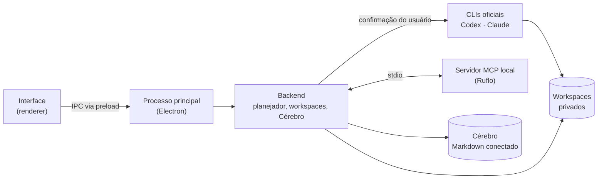

# 🥪 SanduBAH

**Um ambiente desktop para planejar projetos com agentes de IA (Codex e Claude) sem perder o contexto.**

> 🇺🇸 **In English:** SanduBAH is a Windows desktop app (Electron + Node.js) that lets developers plan projects with AI agents (OpenAI Codex and Anthropic Claude via their official CLIs and a local MCP server), keep project knowledge in linked Markdown, and approve every action before it runs. [Live demo](https://lgsmangolt.github.io/SanduBAH/) · [Download v0.1.0](https://github.com/lgsMangolt/SanduBAH/releases/tag/v0.1.0)

[](https://github.com/lgsMangolt/SanduBAH/actions/workflows/test.yml)


<!-- TODO: gravar um GIF de 10–20s do app em uso, salvar em assets/demo.gif e trocar a imagem abaixo -->


**[▶ Abrir a demonstração online](https://lgsmangolt.github.io/SanduBAH/)** · **[↓ Baixar para Windows (v0.1.0)](https://github.com/lgsMangolt/SanduBAH/releases/tag/v0.1.0)**

---

## O problema

Quem programa com agentes de IA perde o fio rápido: o contexto do projeto fica espalhado em conversas, o agente esquece decisões anteriores e é difícil saber o que ele vai executar antes de executar.

O SanduBAH organiza isso em um só lugar:

- **Planejamento com IA:** você descreve a ideia e o agente (Codex ou Claude) ajuda a quebrar em etapas, sempre com confirmação antes de enviar qualquer dado.
- **Cérebro:** uma base de conhecimento em Markdown conectado, que dá ao agente o contexto do projeto.
- **Etapas do produto:** Planejamento → Protótipo → MVP → Produção, separadas das tarefas, para que terminar uma tarefa não seja confundido com produto pronto.
- **Você no controle:** nada é enviado ao modelo, executado ou instalado sem a sua confirmação.

## Stack

| Camada | Tecnologias |
| --- | --- |
| Aplicativo desktop | Electron, Node.js (CommonJS + ES Modules), HTML/CSS |
| Integração com IA | Codex CLI, Claude Code CLI, servidor MCP local via stdio |
| Modelos locais (experimental) | Python, Qwen, AirLLM |
| Build e distribuição | electron-builder, PowerShell, instalador Windows x64 com SHA-256 |
| Testes e CI | `node:test`, Playwright, GitHub Actions com VM Windows limpa |

## Rodar em 2 minutos

Requer [Node.js 22+](https://nodejs.org/).

```bash
git clone https://github.com/lgsMangolt/SanduBAH.git
cd SanduBAH
npm test     # testes da demonstração web, sem dependências
npm start    # abre a demonstração em http://localhost:3000 (baixa o pacote serve na primeira vez)
```

Sem Node, também funciona abrindo `index.html` direto no navegador.

Para o aplicativo completo, use o [instalador da Release](https://github.com/lgsMangolt/SanduBAH/releases/tag/v0.1.0) ou veja [como trabalhar no código desktop](desktop/README.md).

## Arquitetura



O backend conversa com o servidor MCP local. As CLIs rodam com MCP, plugins e hooks desativados, e o Codex trabalha só dentro do workspace privado do projeto.

<!-- TODO: criar ARCHITECTURE.md com suas palavras e linkar aqui -->

## Decisões técnicas e desafios

- **Confirmação antes de qualquer envio.** Nenhuma mensagem, arquivo ou comando chega ao modelo sem aprovação explícita. Isso evita gasto de cota inesperado e vazamento de dados do projeto.
- **CLIs oficiais em vez de chaves de API.** Cada pessoa usa a própria conta do Codex ou do Claude. Para isolar as execuções, o app copia a sessão da CLI para um perfil local privado. Nada é enviado a servidores do SanduBAH.
- **Um worker por vez.** Limitar a execução a um agente simultâneo deixa o comportamento previsível e mais fácil de acompanhar.
- **Instalador testado em VM limpa.** Um workflow do GitHub Actions instala, reinstala e desinstala o app em um Windows Server 2025 novo, com dados fictícios, para verificar que o pacote não depende da minha máquina. É um ambiente de teste, não uma garantia para todas as versões do Windows.
- **Demonstração web sem rede.** A prévia pública tem uma Content-Security-Policy que bloqueia qualquer requisição externa, e um teste automatizado garante isso.

<!-- TODO: troque ou complete com os desafios que VOCÊ enfrentou — é isso que o recrutador quer ler -->

## Funcionalidades

**Principal**

- Novo projeto com planejamento guiado por IA
- Meus projetos, com busca e continuidade
- Cérebro: base de conhecimento em Markdown
- Etapas do produto e checklist de MVP
- Conexões com Codex e Claude

**Experimental**

- Escritório em pixel art com os agentes representados
- Modelos locais (Qwen/AirLLM) e preparação de fine-tuning
- Skill de consulta jurídica

Veja o que vem pela frente no [ROADMAP](ROADMAP.md).

## Estrutura do repositório

```text
index.html, app.mjs, style.css   demonstração web (GitHub Pages)
tests/                           testes da demonstração (npm test)
desktop/                         código do app desktop (overlay sobre o Ruflo)
  src/sandubah-desktop/          interface e processo principal
  scripts/                       build, instalador e MCP
  tests/                         testes de regressão
ci/, .github/workflows/          testes da demonstração e validação em VM Windows limpa
ROADMAP.md                       pendências
```

## Privacidade e segurança

- O código do SanduBAH não envia telemetria. A demonstração web não faz nenhuma requisição de rede.
- O login é feito nas CLIs oficiais. O SanduBAH copia a sessão só para um perfil local privado, nunca a publica ou envia a terceiros.
- Os dados do usuário ficam separados do programa e são preservados em reinstalações.
- O instalador ainda não tem assinatura de código do Windows. Confira o SHA-256 na Release antes de instalar.

Mais detalhes em [SECURITY.md](SECURITY.md).

## Créditos

O app desktop é construído sobre o [Ruflo](https://github.com/ruvnet/ruflo) (MIT). Desenvolvido com auxílio de Claude e Codex; arquitetura, decisões e validação são minhas.

## Autor

**lgsMangolt** · [GitHub](https://github.com/lgsMangolt)

<!-- TODO: adicionar nome e LinkedIn -->

## Licença

MIT. Veja [LICENSE](LICENSE).
