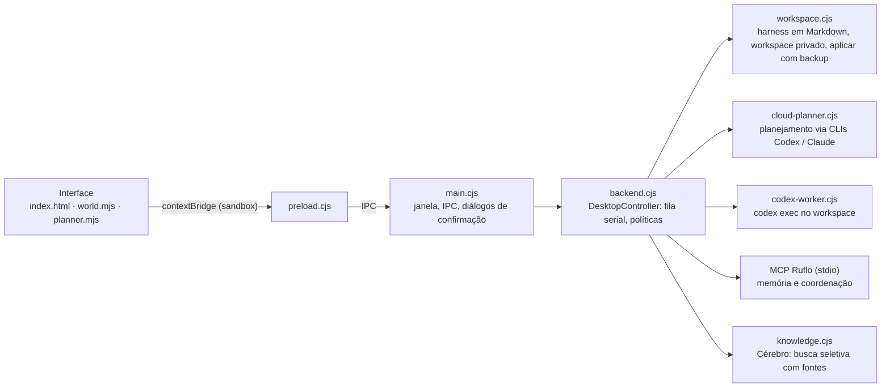

# 🥪 SanduBAH

**App desktop para planejar projetos de software com agentes de IA (Codex e Claude) sem perder o contexto do projeto, com confirmação humana antes de cada ação.**

> **In English:** SanduBAH is a Windows desktop app (Electron + Node.js) that lets developers plan and run software projects with AI coding agents (OpenAI Codex CLI, Claude Code) while keeping project context in Markdown and requiring explicit human approval before any data is sent to a model or any change is applied. Stack: Electron · Node.js · MCP · PowerShell · GitHub Actions. [Live demo](https://lgsmangolt.github.io/SanduBAH/) · [Windows installer 0.1.0](https://github.com/lgsMangolt/SanduBAH/releases/tag/v0.1.0)

[](https://github.com/lgsMangolt/SanduBAH/actions/workflows/sandubah-site-journey.yml)
[](https://github.com/lgsMangolt/SanduBAH/actions/workflows/sandubah-desktop-release.yml)


**[▶ Abrir a demonstração web](https://lgsmangolt.github.io/SanduBAH/)** · **[↓ Instalador Windows x64 0.1.0](https://github.com/lgsMangolt/SanduBAH/releases/download/v0.1.0/SanduBAH-Setup-0.1.0-x64.exe)** (≈ 508 MiB, [SHA-256 e relatório da VM](https://github.com/lgsMangolt/SanduBAH/releases/tag/v0.1.0))

## Stack

**Electron 44** · **Node.js 24** · **MCP** (servidor local por stdio, via [Ruflo](https://github.com/ruvnet/ruflo)) · **PowerShell / C#** (launcher e build Windows) · **Playwright** (testes de interface) · **GitHub Actions** (instalador testado em VM Windows limpa) · Python (experimental, modelos locais)

## O que ele faz

**Principal**

- **Planejamento com agentes:** você descreve a ideia e escolhe Codex ou Claude, o modelo e a força de raciocínio. Antes de qualquer chamada, o app mostra exatamente o que será enviado.
- **Execução isolada:** o Codex trabalha num workspace privado por projeto. O resultado só chega à sua cópia depois de revisão, com backup e detecção de conflito.
- **Contexto persistente:** cada projeto (harness) guarda objetivo, equipe, missões e memória em arquivos Markdown, que são relidos a cada missão.
- **Fila serial:** só um worker por vez, sem repetição automática. A fila para no primeiro erro.

**Experimental**

- **Cérebro:** busca seletiva nos seus Markdown, que mostra as fontes usadas e separa tokens estimados dos tokens informados pelo provedor.
- **Grill-me:** entrevista que questiona a ideia antes de planejar.
- **Escritório:** visualização em pixel art dos papéis dos agentes.
- **Referência jurídica:** consulta seletiva de normas por jurisdição, com a indicação de confirmar na fonte oficial.
- **Modelos locais (Qwen/AirLLM):** síntese local sem executar comandos.

## Rodar em 2 minutos

**Demonstração web.** É estática, sem dependências, login ou chamadas de API:

```bash
git clone https://github.com/lgsMangolt/SanduBAH.git
cd SanduBAH
python -m http.server 8000   # depois abra http://localhost:8000
```

Também funciona abrindo `index.html` direto no navegador. Os projetos e resultados exibidos são fictícios.

**App desktop.** Use o [instalador](https://github.com/lgsMangolt/SanduBAH/releases/tag/v0.1.0) e siga o [tutorial interativo para instalar e conectar Codex ou Claude](https://lgsmangolt.github.io/SanduBAH/#install). Cada pessoa usa a própria CLI oficial e a própria conta.

**Código do desktop.** Fica em [`desktop/`](desktop/README.md) e hoje é um *overlay* sobre o Ruflo. Ainda não roda sozinho a partir deste clone: montar o ambiente reproduzível com um único comando está no roadmap.

## Arquitetura



O renderer não tem acesso ao Node (`contextIsolation`, `sandbox`, `nodeIntegration: false`). Toda ação com efeito colateral passa pelo processo principal e por uma confirmação nativa.

## Decisões técnicas e desafios

- **Confirmação antes de enviar dados ao modelo.** Contexto privado e cota são do usuário. Por isso o app exibe a mensagem e os Markdown selecionados antes da chamada. Se o contexto passar do limite, a chamada é bloqueada em vez de ter o texto cortado sem aviso.
- **O resultado do agente nunca sobrescreve sua cópia diretamente.** O Codex escreve num workspace separado. Para aplicar, o app compara o hash SHA-256 da origem com o do momento da preparação, recusa se outra pessoa ou agente alterou o arquivo e guarda um backup.
- **Um worker por vez.** Rodar agentes em série evita dois escritores no mesmo arquivo e torna cada resultado rastreável. Uma interrupção vira estado "desconhecido" e nunca é repetida automaticamente.
- **Instalador testado em VM limpa.** Um workflow do GitHub Actions instala, abre, reinstala e desinstala o app numa VM Windows Server 2025 nova, com dados fictícios, e verifica que os dados do usuário são preservados.
- **Testes de regressão.** Mais de 200 testes com `node:test`, executados em série, cobrem caminhos maliciosos (UNC, ADS, hardlinks, `..`), manifestos adulterados, conflitos, cancelamentos e a fila.

## Roadmap

- Ambiente de desenvolvimento reproduzível a partir de um clone (fork do Ruflo ou script de setup com commit fixado).
- Checkpoints por missão, com diff e restauração confirmada.
- Gates de qualidade determinísticos, com evidências de testes e artefatos.
- Nova Release do instalador. Os fontes em `desktop/` são posteriores à 0.1.0, e publicar fontes não atualiza o instalador.

O estado detalhado está em [`desktop/CLAUDE.md`](desktop/CLAUDE.md).

## Privacidade e segurança

A demonstração web não usa analytics, formulários, fontes remotas nem chamadas de API. O app desktop é uma prévia experimental, ainda sem certificado Authenticode. Ele não inclui CLIs, contas, chaves ou modelos, e verifica atualizações só com a sua confirmação. Para vulnerabilidades, veja [`SECURITY.md`](SECURITY.md). Não publique tokens, logs ou dados de clientes em issues.

## Créditos e licença

Construído sobre o [Ruflo, de ruvnet](https://github.com/ruvnet/ruflo) (MIT), cuja licença é preservada em [`LICENSE`](LICENSE). Este não é um release oficial do Ruflo. Os nomes dos provedores pertencem aos respectivos titulares, sem afiliação implícita.

Desenvolvido com auxílio de Claude e Codex; arquitetura, decisões e validação são minhas.

**Uma etapa verificável por vez. Bah.**
